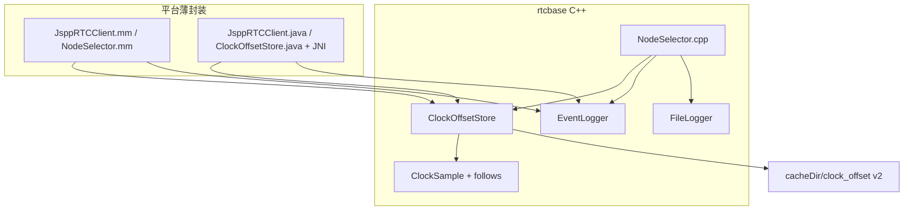
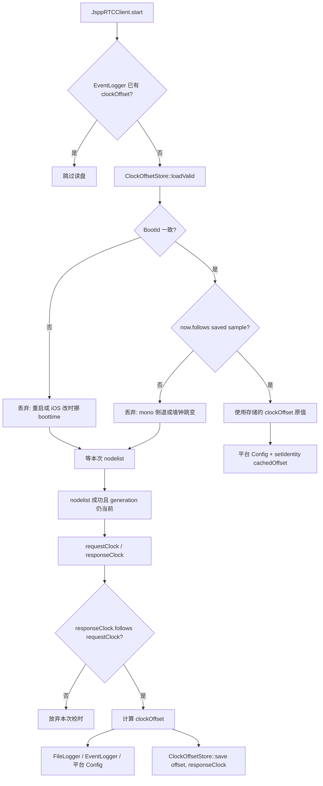
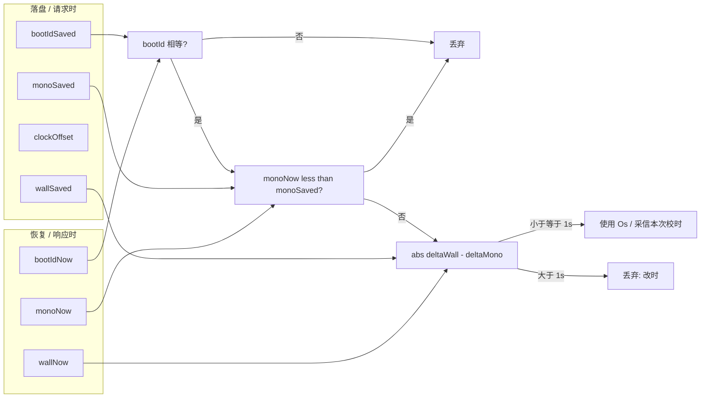
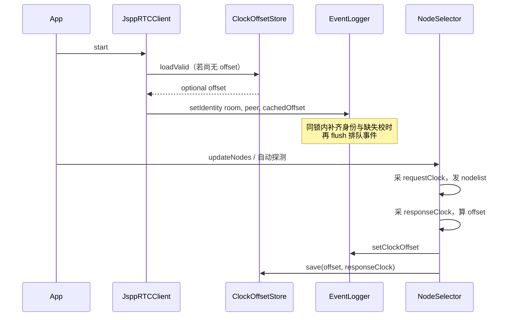

# clockOffset 持久化

## 目标

nodelist 返回前也能校时：把上次成功的 `clockOffset` 落盘；启动时若「同 boot + 墙钟相对 boot-mono 跳变 ≤1s」则恢复原值，否则丢弃并等本次 nodelist。不引入 NTP，不做 mono 外推。

实现重心在 **rtcbase**：校验与 IO 只写一份；ObjC / Java 只做薄钩子。

## 核心公式

nodelist 响应里带服务端 `current_time` 时：

```text
clockOffset = current_time - responseTime + max(0, HTTP_RTT) / 2
```

- `current_time`：服务端生成响应时的时间
- `responseTime`：客户端收到响应时的本地墙钟
- RTT 从 TLS 握手完成后起算，不含建连；假设上下行近似对称

校时权威来源 **仅 nodelist**。缓存只是把同 boot、未改时的结果提前装上。

## 原理图

### 分层



### 整体数据流



### 有效性判定（`follows`）



`ClockSample::follows(earlier)` 含义：当前采样可作为 `earlier` 之后的合法点——`earlier` 有效、mono 未倒退，且 `(Δwall − Δmono)` 在 ±1s 内。

用途两处：

| 场景 | earlier | later | 失败则 |
|---|---|---|---|
| nodelist 校时 | `requestClock` | `responseClock` | 不计算 / 不落盘本次 offset |
| 读缓存 | 落盘时的 wall/mono | `ClockSample::now()` | `loadValid` 返回空 |
| save 写入前 | 传入的 `sample`（响应采样） | `now()` | 不覆盖磁盘 |

### 与 EventLogger 的时序



## 重启检测

`monoNow < monoSaved` **只能覆盖「新开机 uptime 仍小于旧 monoSaved」**。若重启后跑得更久，单靠 mono 会漏判。

多数漏判仍会被 `|Δwall − Δmono| > 1s` 挡住，但快重启 + 很小的 monoSaved + 很短关机仍可能误用。

**主信号：持久化本次开机身份 `BootId`，恢复时必须一致。**

| 平台 | BootId | 单调时钟 | 勿用 |
|---|---|---|---|
| Android | `/proc/sys/kernel/random/boot_id`（每次开机新 UUID） | `CLOCK_BOOTTIME` | `CLOCK_MONOTONIC`（休眠不走） |
| iOS | `sysctl kern.boottime` → usec 字符串 | `CLOCK_MONOTONIC_RAW` | `CLOCK_UPTIME_RAW` / `mach_absolute_time` / `CACurrentMediaTime` |

辅信号：`monoNow < monoSaved` → 直接丢弃。

说明：iOS 的 `kern.boottime` **改系统时间时也可能被内核挪动** → 会当成「重启」丢掉缓存（偏保守，可接受）。Android `boot_id` 与墙钟无关。

不采用：`BOOT_COUNT`（非 C 统一）、纯墙钟间隔、跨重启盲用旧 offset、`anchorServer + Δmono` 外推。

## 落盘格式

路径：`Config::cacheDir/clock_offset`（与 zstd / event pending 同目录模式）。

```text
v2
<offsetMs>
<wallMs>      # 响应回调采样，非写入瞬间
<monoMs>
<boot_id>     # 无空格
```

- 写入：同目录 `mkstemp` 独立临时文件 → `fclose` 成功后再 `rename` 替换；失败保留旧文件。
- 旧 `v1`（落盘瞬间采样、无 boot_id）：读到非 `v2` 直接跳过，等下次 nodelist 重写。

## API

```cpp
namespace bff {

struct ClockSample {
    int64_t wallMs;
    int64_t monoMs; // 含休眠的开机单调时钟
    static ClockSample now() noexcept;
    bool follows(ClockSample earlier) const noexcept;
};

struct ClockOffsetStore {
    // cacheDir 空则 no-op；写入前要求 now.follows(sample)
    static void save(int64_t offsetMs, ClockSample sample) noexcept;
    // BootId 不一致 / follows 失败 → nullopt
    static std::optional<int64_t> loadValid() noexcept;
};

}
```

内部还有 `MonotonicBootMs` / `CurrentBootId`（实现细节，不对外暴露）。Android 经 `clock_offset_jni.cpp` 暴露 `nativeSave` / `nativeLoadValid`（无效哨兵 `Long.MIN_VALUE`）。

## 平台钩子

| 时机 | iOS | Android |
|---|---|---|
| 恢复 | `JsppRTCClient.start`：`loadValid` → `SetJsppRTCClockOffset` + Config；`setIdentity(..., cachedOffset)` | `ClockOffsetStore.loadForStart` → Config / FileLogger；`setIdentity` 带缓存 |
| 写入 | `NodeSelector.mm` / base `NodeSelector.cpp` 算完后 `save` | `NodeSelector.java` → `applyAndSave` → JNI `nativeSave` |
| 已有 offset | 跳过读盘并打日志 | 同左（与 nodelist 写入串行，避免启动读覆盖刚校完的值） |

### generation 门闩

每次 `updateNodes` 递增 generation；HTTP 回调里若 generation 已不是当前或不再 pending，**不** apply / save clockOffset，避免过期 nodelist 覆盖新会话校时。

## 日志（tag `clock`）

| 结果 | 示例 |
|---|---|
| 使用缓存 | `clockOffset cache used: offset=…ms` |
| 未使用 | 在失败分支：`cacheDir empty` / `no file` / `bad format` / `bootId mismatch` / `mono regress` / `wall-mono skew` / `already have offset` |
| 落盘 | `clockOffset saved`；跳过则在对应条件处说明原因 |

## 非目标

- 不引入 NTP / HTTPS Date
- 重启后不盲用旧 offset
- 不做 `anchorServer + Δmono` 外推
- 不把节点列表缓存从 prefs 迁到 base（本任务只动 clockOffset）
